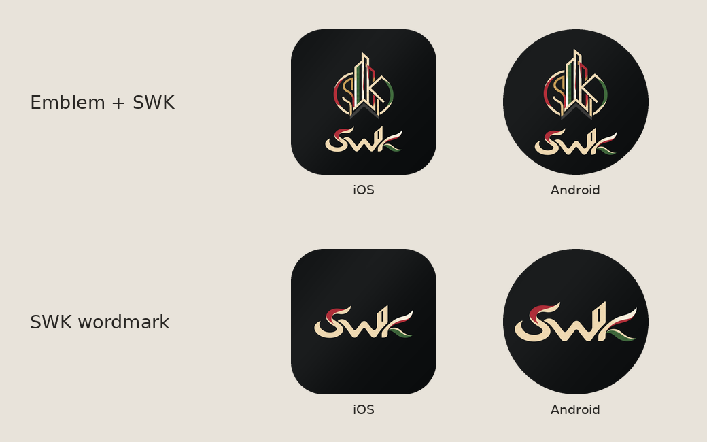

# SWK Rent (`swk.rent`) — UAE Dedicated Rental Marketplace & Tenancy Platform

<p align="center">
  
</p>

<p align="center">
  
</p>

**UAE's Dedicated Verified Rental Platform (`https://swk.rent`)** — built for **SWK Properties L.L.C.** (RERA ORN `51517`) with an **API-First External OS Bridge (`/api/os-api/*`)**. Ready for the **First 1,000-User MVP Launch** across Web (`https://swk.rent`), Native Android (`ae.swk.rent`), and iOS (`ae.swk.rent`).

---

## 🔗 External OS REST API & Webhook Integration (`/api/os-api/*`)

`swk.rent` operates as an independent, self-contained rental platform and integrates with external operating systems strictly via **REST API & Webhooks**:
- **`GET /api/os-api/status`**: Returns active OS REST API configuration (`SWK_OS_API_URL`, default `https://api.os.swk.rent`), webhook endpoint (`https://swk.rent/api/os-api/webhook`), and recent sync telemetry.
- **`POST /api/os-api/config`**: Dynamically updates the external OS API base URL, API key, and auto-sync mode.
- **`POST /api/os-api/sync-inventory`**: Pulls Title-Deed and Key-Vault verified rental inventory via REST API (`GET {SWK_OS_API_URL}/api/public/properties?purpose=rent` or direct JSON payload).
- **`POST /api/os-api/webhook`**: Receives real-time inbound webhooks from the external OS for unit availability locks, rent updates, and key-vault status changes.

---

## 🔐 8 Dedicated Role Demo Accounts, Sign-In / Registration Portal & Connected Custom Usage Engine

Every account is protected with cryptographic `scrypt` password hashing, `SHA-256` session tokens (`swkrent_session`), brute-force lockout protection, `@fastify/helmet`, and `@fastify/rate-limit`. In addition, every user has a persistent **Connected Custom Usage Profile (`user_custom_usage`)** controlling their default cheque split, custom flat fee/commission override, preferred emirate, DIFC commute threshold, personal REST API key, custom webhook URL, WhatsApp pitch signature, and live usage telemetry counters (`GET /api/auth/custom-usage`, `POST /api/auth/custom-usage`, `POST /api/auth/custom-usage/track`).

| Role & Persona | Demo Email | Demo Password | Connected Custom Usage & Key Capabilities |
| :--- | :--- | :--- | :--- |
| **`ADMIN` · SWK Managing Director** | `admin@swk.rent` | `SwkRent2026!` | Full 1,000-User MVP cohort telemetry, OS REST API bridge config, compliance audit trail, workflow override (`320` synced units, `AED 480k/yr` saved). |
| **`AGENT` · SWK Exclusive Advisor** | `advisor@swk.rent` | `SwkRent2026!` | `AED 0` CRM XML feed import, 60-min GPS key vault dispatch, 1-Tap WhatsApp client pitch, `50/50` split (`48` synced units, `AED 84k/yr` saved). |
| **`AGENT` · External A2A Partner** | `partner@apexcrest.ae` | `SwkRent2026!` | Protected 7-day A2A client registration & automated `50% Partner / 25% SWK / 25% Advisor` split lock (`64` synced units, `AED 112k/yr` saved). |
| **`LANDLORD` · Direct Owner360 (Tier 1)** | `landlord@swk.rent` | `SwkRent2026!` | Direct Title Deed onboarding (`AED 0` landlord fee · Tenant pays flat `AED 2,999`), Stage 3 1-Click Offer Approval, 90-day RERA notice shield. |
| **`LANDLORD` · Family Office (Tier 3)** | `familyoffice@swk.rent` | `SwkRent2026!` | Institutional portfolio owner receiving `100% 1-Cheque Upfront Day-1 Payout` while tenants pay `12x Monthly UAEDDS` (`14` active units). |
| **`DEVELOPER` · BTR Handover Director** | `developer@selectgroup.ae` | `SwkRent2026!` | Bulk Tower Handover BTR Pools, FIFO Anti-Cannibalization public queue caps (`max 3 units/layout`), RERA yield floor guard (`AED 240k/yr` saved). |
| **`TENANT` · UAE PASS Executive** | `tenant@uaepass.ae` | `SwkRent2026!` | `12x Monthly UAEDDS` autopay, True Monthly All-In Cost Calculator, Instant GPS/Smart-Lock viewings, 48h Offer Lock, RERA Renewal Shield. |
| **`TENANT` · New Expat 30-Day Bridge** | `expat@swk.rent` | `SwkRent2026!` | `30-Day DTCM Bridge-to-Ejari` legal entry with Passport + Visa Application Receipt while Emirates ID & UAE bank account clear. |

---

## 🔄 7-Stage End-to-End UAE Rental Deal Workflow

1. **Stage 1 · `KYC_AND_VIEWING`** (`TENANT`, `AGENT`, `ADMIN`): UAE PASS / Passport KYC & verified GPS or Smart-Lock viewing.
2. **Stage 2 · `OFFER_AND_DEPOSIT_LOCK`** (`TENANT`, `AGENT`, `ADMIN`): Binding digital offer + `AED 2,000` Corporate Escrow 48h unit lock (hard-blocks personal advisor bank accounts).
3. **Stage 3 · `LANDLORD_APPROVAL`** (`LANDLORD`, `AGENT`, `ADMIN`): Landlord 1-click acceptance in Owner360.
4. **Stage 4 · `CONTRACT_AND_PAYMENTS`** (`TENANT`, `LANDLORD`, `AGENT`, `ADMIN`): DLD Unified Tenancy Contract signed + PDC Cheques vaulted or UAEDDS monthly direct debit active.
5. **Stage 5 · `EJARI_TAWTHEEQ_ISSUED`** (`AGENT`, `LANDLORD`, `ADMIN`): Auto-issues official DLD Ejari / Abu Dhabi Tawtheeq certificate (`EJARI-2026-*`) and locks the commission split ledger.
6. **Stage 6 · `DEWA_CHILLER_AND_SNAGGING`** (`TENANT`, `AGENT`, `ADMIN`): DEWA + Empower/Tabreed activation & 50-point move-in snagging photo vault locked.
7. **Stage 7 · `MOVE_IN_NOC_AND_KEYS`** (`AGENT`, `LANDLORD`, `ADMIN`): Auto-generates Building OA Security QR Move-In Gate Pass (`NOC-PASS-*`) and completes key handover (`COMPLETED_ACTIVE_LEASE`).

---

## 📱 Native Android (`android/`) & iOS (`ios/SWKRent/`) Apps (`ae.swk.rent`)

Both official **SWK Matte Gold** app icon variants (**Emblem + SWK** and **SWK Wordmark**) are bundled in:
- **Android (`android/app/src/main/res/mipmap-*` & `ic_launcher-playstore.png`):** Application ID `ae.swk.rent`, deep-link scheme `swkrent://open`, adaptive launcher icons (`v26` & `v33`), dynamic `<activity-alias>` icon switcher (`SwkAndroidBridge.setLauncherIconVariant`), Gradle 8.9 wrapper, and automated GitHub Actions APK/AAB workflow (`.github/workflows/android-apk.yml`).
- **iOS (`ios/SWKRent/Assets.xcassets/`):** Bundle ID `ae.swk.rent`, `AppIcon.appiconset` (Primary Emblem + SWK `1024x1024`) and `AppIconWordmark.appiconset` (Alternate SWK Wordmark `1024x1024`) with `WKWebView` + FaceID/TouchID bridge (`SwkIosBridge`).

---

## 🚀 Quick Start

```bash
npm run dev          # Starts API (:8090) + Web (:5175)
npm run typecheck    # TypeScript validation (0 errors)
npm test             # Run 21/21 swk.rent, OS REST API, RBAC & 7-Stage Workflow checks
npm run build        # Production Web + Server bundle
npm run mobile:sync  # Sync production Web bundle into Android & iOS native assets
```
