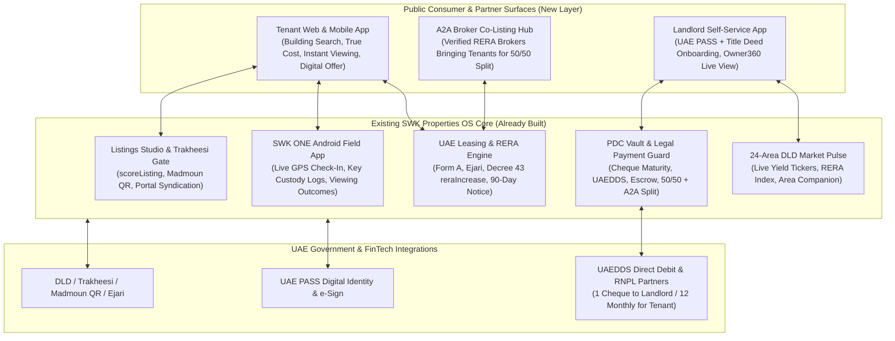
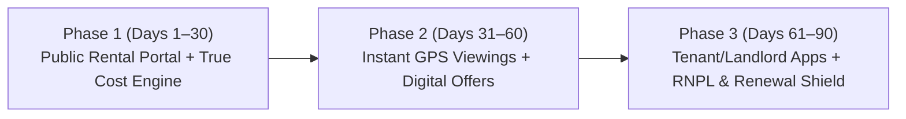

# SWK Rent: Master Business & Product Plan for a Dedicated UAE Rental Ecosystem
**Powered by [SWK Properties OS](file:///C:/Users/Shahid/.gemini/antigravity/scratch/swkpropertiesOS/README.md) (RERA ORN `51517`)**

> [!IMPORTANT]
> **Your Unfair Advantage:** Bayut, Property Finder, and Dubizzle are **disconnected advertising boards**. They only sell leads; they have zero visibility or control over what happens *after* a tenant clicks "WhatsApp." Because you already own **[SWK Properties OS](file:///C:/Users/Shahid/.gemini/antigravity/scratch/swkpropertiesOS/PRODUCT.md)**—with a live Leasing ERP, [Trakheesi & Decree 43 RERA engine](file:///C:/Users/Shahid/.gemini/antigravity/scratch/swkpropertiesOS/src/shared/uae-rules.ts), [PDC Cheque Vault](file:///C:/Users/Shahid/.gemini/antigravity/scratch/swkpropertiesOS/src/web/pages/swk/PdcVault.tsx), [Owner 360 Portal](file:///C:/Users/Shahid/.gemini/antigravity/scratch/swkpropertiesOS/src/web/pages/swk/Owner360.tsx), [Physical Key Custody Logs](file:///C:/Users/Shahid/.gemini/antigravity/scratch/swkpropertiesOS/src/server/schema.ts#L140-L153), and [SWK ONE Android GPS Field App](file:///C:/Users/Shahid/.gemini/antigravity/scratch/swkpropertiesOS/src/server/domain/swk-one.ts)—you can launch the **UAE's First Operating-System-Backed Transactional Rental Platform**.

---

## 1. Exhaustive Analysis: 18 Real-World UAE Rental Loopholes & Scenarios (And How We Solve Them)

To beat billion-dirham incumbents, your platform must systematically close the **18 operational, financial, and legal loopholes** that frustrate UAE tenants, landlords, and honest brokers every day.

### Category A: Discovery & Listing Loopholes (Before Viewing)

| # | Real-World UAE Scenario / Loophole | Why Bayut / PF Fail to Stop It | How Your Platform + `swkpropertiesOS` Solves It |
| :--- | :--- | :--- | :--- |
| **1** | **The "Bait-and-Switch" Ghost Listing:** A luxury 1BR in Dubai Marina is listed at `AED 85,000` (market is `AED 110,000`). When the tenant messages on WhatsApp, the agent says *"Just rented 1 hour ago, but I have another unit for AED 115,000."* | Portals charge agencies per listing/credit and do not sync in real time with signed tenancy contracts or deposit receipts. | **OS-Locked Availability State:** A listing on your portal is directly bound to [`units`](file:///C:/Users/Shahid/.gemini/antigravity/scratch/swkpropertiesOS/src/web/pages/swk/ListingsStudio.tsx#L80-L95) and [`leases`](file:///C:/Users/Shahid/.gemini/antigravity/scratch/swkpropertiesOS/src/server/domain/uae.ts#L10-L28). The moment a booking deposit is logged or an Ejari lease is active, the public listing **auto-locks to "Reserved/Rented"** within 1 second—zero human intervention. |
| **2** | **15 Duplicate Ads for the Same Apartment:** A landlord gives an open mandate to 10 agencies. Tenants scroll through 15 identical listings of the same JVC apartment with conflicting prices (`AED 68k`, `AED 70k`, `AED 75k`) and watermarked photos. | Portals profit from every duplicate ad because 15 agents each pay listing credits for the same unit. | **Building-First, Unit-Deduplicated Architecture:** Deduplicate inventory by **Makani + Building + Unit Number + Title Deed**. If multiple A2A brokers have a Form A for Unit 1204, the tenant sees **ONE canonical unit page** with verified floorplans and transparent price/cheque terms. |
| **3** | **The "District Cooling / Chiller Trap":** A tenant rents an apartment for `AED 80,000/yr` thinking it's affordable, only to discover after moving in that Empower/Tabreed charges a `AED 2,000` deposit + `AED 9,000/yr` in capacity & consumption fees. | Portals bury "Chiller Free" in unstructured text descriptions and never calculate utility costs. | **Mandatory Utility & Chiller Intelligence:** Every building profile stores structured utility metadata (`Chiller Free`, `Empower`, `Tabreed`, `DEWA only`, `Gas Type`) and displays the **True Monthly All-In Cost** directly on the search card. |
| **4** | **The "Unlisted Cheque Price Inflation":** Ad says `AED 90,000/yr`. At viewing, the agent says *"AED 90k is only for 1 cheque; if you want 4 cheques it’s AED 100,000, and 12 cheques isn't accepted."* | Portals only store a single `annual_rent` integer and a static `cheques` count. | **Dynamic Cheque-Tier Pricing Matrix:** Every listing displays an explicit interactive pricing toggle: `1 Cheque: AED 90,000` · `2 Cheques: AED 92,000` · `4 Cheques: AED 95,000` · `12 Monthly (RNPL/DDS): AED 8,350/mo`. |
| **5** | **Commute & Traffic Blindness:** New expats rent in JVC, Arjan, or Production City based on map distance ("12 km to Downtown"), unaware that peak 8:30 AM Hessa Street / Al Khail exit traffic takes 55 minutes. | Portals only offer polygon/community filters, not rush-hour commute time filters. | **Rush-Hour Commute & Metro Walkability Engine:** Filter properties by *"Max 25 mins to DIFC/Media City at 8:30 AM"* and exact walking minutes (in summer shade vs. winter) to the nearest Metro/Tram station. |

---

### Category B: Viewing, Broker & Negotiation Loopholes (During Deal)

| # | Real-World UAE Scenario / Loophole | Why Bayut / PF Fail to Stop It | How Your Platform + `swkpropertiesOS` Solves It |
| :--- | :--- | :--- | :--- |
| **6** | **The "Who Actually Has the Key?" Runaround:** Tenant books a viewing for 5:00 PM. Agent shows up late and says *"Security won't let us in"* or *"The previous agent took the key."* | Portals have no idea who holds the physical key or access card for a vacant unit. | **Live Key Custody Badge (`SWK Key In-Hand`):** Powered by [`property_key_logs`](file:///C:/Users/Shahid/.gemini/antigravity/scratch/swkpropertiesOS/src/server/schema.ts#L140-L153) in `swkpropertiesOS`. Units where SWK holds the verified physical key in the vault display an **"Instant Viewing — Key in SWK Custody"** badge with guaranteed 60-minute viewing slots. |
| **7** | **Agent Ghosting & Fake Viewing Attendance:** Agents claim they showed a landlord's property 10 times this week to justify asking the landlord to drop the rent, when zero viewings actually happened. | No GPS or field verification exists on listing portals. | **GPS-Verified Viewing Proof for Landlords:** Powered by [`SWK ONE Android`](file:///C:/Users/Shahid/.gemini/antigravity/scratch/swkpropertiesOS/README.md#L35-L49) (`duty_location_batches` & `POST /api/swk-one/viewings/:id/arrive`). Landlords see real-time GPS-verified viewing timestamps and anonymized tenant feedback in [`Owner360`](file:///C:/Users/Shahid/.gemini/antigravity/scratch/swkpropertiesOS/src/web/pages/swk/Owner360.tsx). |
| **8** | **The A2A (Agent-to-Agent) Chain Dysfunction:** Tenant's agent talks to a middle agent who talks to the landlord's agent. Offers get distorted, responses take 4 days, and deals collapse over komis/commission splits. | Portals don't acknowledge or structure A2A co-brokering for rentals. | **Protected A2A Smart-Match & Split Contract:** Built on [`leaseHooks`](file:///C:/Users/Shahid/.gemini/antigravity/scratch/swkpropertiesOS/src/server/domain/uae.ts#L20-L26) (`is_third_party_a2a`, `company_50_share`, `advisor_50_share`). External RERA brokers can submit a verified tenant directly into an SWK mandate with an auto-locked digital A2A commission split agreement. |
| **9** | **WhatsApp Offer Chaos & "Gazumping":** Tenant agrees verbally on WhatsApp, goes to the bank to print manager's/PDC cheques, and meanwhile the agent rents the unit to someone else who paid cash deposit faster. | Negotiations happen in unrecorded WhatsApp chats with no binding digital reservation flow. | **Structured Digital Offer & 24-Hour Unit Lock:** Tenant submits a formal digital offer (Move-in date, Cheque split, Emirates ID/UAE PASS KYC, + refundable `AED 2,000` instant holding deposit to **SWK Company Escrow/Bank Account**). Once accepted by the landlord, the unit is locked for 48 hours to complete Ejari. |
| **10** | **Rogue Agent Personal Account Scam:** Dishonest agents ask tenants to transfer the security deposit or first rent installment to the agent's *personal* bank account or cash "to hold the unit," then vanish or delay handover. | Portals don't process or guard payments. | **Hard OS Payment Guard:** Already enforced in [`salesContractHooks`](file:///C:/Users/Shahid/.gemini/antigravity/scratch/swkpropertiesOS/src/server/domain/uae.ts#L30-L38)! The consumer app displays a live **"Verified UAE Payment Shield"**—payments only clear into `SWK Company Bank Account`, `Verified Landlord IBAN (matched to Title Deed)`, or `UAEDDS`. |

---

### Category C: Move-In, Tenancy, Deposit & Renewal Loopholes (Post-Deal Lifecycle)

| # | Real-World UAE Scenario / Loophole | Why Bayut / PF Fail to Stop It | How Your Platform + `swkpropertiesOS` Solves It |
| :--- | :--- | :--- | :--- |
| **11** | **The "Unfair Security Deposit Deduction" at Move-Out:** Tenant pays a `AED 5,000–10,000` deposit. At move-out, the landlord blames the tenant for pre-existing cracked tiles or old AC faults and refuses to return the deposit. | Portals disappear the day the lease is signed. | **Timestamped Move-In Snagging & Deposit Vault:** Before key handover (tied to `tests/handover.ts` & `job_closure_evidence`), the advisor and tenant record a **timestamped, geo-tagged 50-point photo/video snagging report** stored in `swkpropertiesOS`. At move-out, AI compares move-in vs. move-out photos to prevent unfair deductions. |
| **12** | **The "AED 500 Maintenance Threshold" Grey Zone:** In UAE rentals, minor maintenance (`< AED 500`) is typically the tenant's responsibility and major maintenance (`> AED 500`) is the landlord's. Tenants and landlords constantly fight over whether an AC capacitor or plumbing leak is minor or major, and landlords ghost repair requests. | No maintenance workflow exists in listing portals. | **SLA-Backed Maintenance & Auto-Deduct Protection:** Connected directly to [`Owner360` Pending Maintenance](file:///C:/Users/Shahid/.gemini/antigravity/scratch/swkpropertiesOS/src/web/pages/swk/Owner360.tsx#L29-L36). Tenants log an issue with a photo; vetted contractors quote within 4 hours; if it's `> AED 500`, the landlord approves in 1 click from WhatsApp/Owner Portal. |
| **13** | **Illegal Rent Hikes & Missed 90-Day Notice:** Landlord messages the tenant 30 days before expiry demanding a 25% rent hike, violating Dubai Law No. 33 of 2008 (90-day written notice rule) and Decree 43 of 2013 (RERA index bands). | Tenants don't know their legal rights or exact RERA calculation, leading to stressful RDS (Rental Dispute Center) cases. | **Automated "90-Day RERA Renewal Shield":** Directly powered by [`renewalCheck()` and `reraIncrease()`](file:///C:/Users/Shahid/.gemini/antigravity/scratch/swkpropertiesOS/src/shared/uae-rules.ts#L23-L74) in `swkpropertiesOS`! At Day 105 before expiry, the system calculates the exact legal maximum rent from the DLD Index, notifies both landlord and tenant, and generates a legally compliant renewal addendum before the 90-day cutoff. |
| **14** | **Bounced PDC Cheques & Landlord Cashflow Disruption:** Tenant's 2nd or 3rd cheque bounces due to signature mismatch or insufficient funds, triggering criminal/civil execution stress and leaving the landlord unpaid. | Portals don't manage post-dated cheques. | **Smart PDC Vault + UAEDDS / RNPL Bridge:** Powered by [`PdcVault.tsx`](file:///C:/Users/Shahid/.gemini/antigravity/scratch/swkpropertiesOS/src/web/pages/swk/PdcVault.tsx). Automated WhatsApp reminders hit the tenant 14, 7, and 2 days before cheque maturity (`Due Soon`). If a tenant needs a 5-day salary delay, they can swap the cheque digitally via card/tabby/RNPL before it hits the bank and bounces. |
| **15** | **The "Fake Landlord Eviction for Sale / Personal Use":** Landlord serves a 12-month notary eviction notice claiming "personal use," evicts the tenant, and immediately re-lists the apartment at a 35% higher rent (illegal under Dubai law for 2 years). | Tenants have no way to monitor if their former unit was illegally re-listed. | **DLD Eviction Watchdog Alert:** Former tenants can subscribe to their old unit's Makani/Title Deed. If the unit is re-listed for rent within 24 months of a "personal use/sale" eviction, the tenant receives an instant alert with evidence for a DLD Rental Dispute compensation claim. |
| **16** | **New Expat "Catch-22" (No Emirates ID = No Chequebook = No Ejari):** Newly arrived executives in Dubai have an employment contract and cash, but their Emirates ID and UAE bank chequebook take 3–5 weeks. They get stuck paying `AED 18,000/mo` in hotels. | Traditional portals separate "Short-Term" and "Annual" into completely disconnected silos. | **"Bridge-to-Ejari" Move-In Program:** Allow newly arrived expats to move into an annual rental immediately under a 30-day DTCM/Bridge agreement paid by international card/crypto (`VARA-licensed gateway` already supported in SWK OS!), which automatically converts to a 12-month Ejari once their Emirates ID is issued. |
| **17** | **Unlicensed Partition / Subletting Risk for Landlords:** A landlord rents a 2BR to a tenant who secretly builds wooden partitions and sublets to 12 people, resulting in Dubai Municipality / Civil Defense fines of `AED 50,000+` against the landlord. | Landlords flying overseas have zero visibility into property condition mid-lease. | **Bi-Annual Visual Asset Inspection (Included in Management):** Every 6 months, an `SWK ONE Android` field inspector conducts a scheduled 10-minute GPS-verified condition & occupancy check, uploading photos directly to the landlord's [`Owner360`](file:///C:/Users/Shahid/.gemini/antigravity/scratch/swkpropertiesOS/src/web/pages/swk/Owner360.tsx) dashboard. |
| **18** | **Move-In Gate Pass & Utility Sequencing Nightmare:** Tenant signs Ejari on Thursday afternoon, hires movers for Saturday, and gets blocked by Emaar/Nakheel/DAMAC security because the Move-In NOC requires activated DEWA + Empower + 48 working hours. | No post-lease onboarding checklist exists for tenants. | **Automated "Move-In Autopilot" Pipeline:** As soon as the lease is signed in `swkpropertiesOS`, the tenant app unlocks a step-by-step tracker: `1. Ejari Issued → 2. DEWA Auto-Triggered → 3. Empower/Tabreed Linked → 4. Developer Move-In Gate Pass (Emaar One / Nakheel / Sakani) Applied → 5. Key Handover Unlocked`. |

---

## 2. Strategic Positioning & Ecosystem Architecture

### The Brand Positioning: **"SWK Rent" (or a Standalone Consumer Brand Powered by SWK OS)**
* **Tagline Idea:** *"Every Unit Verified. Every Dirham Transparent. Every Lease Protected."*
* **Why Tenants Switch from Bayut to You:**
  1. **Zero Duplicate Ads:** 1 Building → 1 Unit → 1 Truth.
  2. **True Monthly Cost Upfront:** Rent + Chiller + DEWA + Fees calculated to the dirham, with **Pay Monthly (12x)** or **1–4 Cheques** options on every listing.
  3. **Instant Key-in-Hand Viewings:** Live GPS-tracked advisors who actually have the key.
  4. **Deposit & Renewal Protection:** Timestamped snagging and RERA Decree 43 rent-cap protection built into the app.
* **Why Landlords List Exclusively with You:**
  1. **100% Free Listing + Full [`Owner360`](file:///C:/Users/Shahid/.gemini/antigravity/scratch/swkpropertiesOS/src/web/pages/swk/Owner360.tsx) Wealth Dashboard.**
  2. **Upfront 1-Cheque Payout Option** (even when the tenant pays monthly via RNPL/UAEDDS partners).
  3. **Live PDC Cheque Vault, GPS Viewing Logs, & Bi-Annual Subletting Inspections.**

### System Architecture: Connecting Public Consumer App to `swkpropertiesOS`

---

## 3. Complete Dedicated Rental Business Model & Revenue Streams

Unlike Bayut—which only makes money by squeezing real estate agencies for ad subscriptions—your OS-backed rental platform captures value across **5 distinct monetization layers** throughout the entire 12-month tenancy lifecycle:

### Revenue Stream 1: Core Leasing Commission (Direct & A2A)
* **Standard SWK Managed/Exclusive Units:** `5%` of annual rent (minimum `AED 5,000`) paid by tenant, split `50% SWK Company / 50% Sales Advisor` via your existing [`agentCommissionHooks`](file:///C:/Users/Shahid/.gemini/antigravity/scratch/swkpropertiesOS/src/server/domain/uae.ts#L40-L55).
* **"Direct-to-Landlord Self-Serve" Tier (Market Wedge):** For cost-sensitive tenants or landlords who list directly without requiring field agent viewings (e.g., tenant views via smart lock or building security), offer a disruptive **`2.5%` or Flat `AED 2,999` Digital Lease Execution Fee**—undercutting traditional brokers by 50% while generating ~90% software gross margin for SWK!
* **A2A Co-Brokering Pool:** When an external RERA-licensed broker brings a tenant to an SWK-exclusive listing (or vice versa), the `5%` commission splits `50% A2A Partner / 25% SWK Company / 25% SWK Advisor` automatically in [`leaseHooks`](file:///C:/Users/Shahid/.gemini/antigravity/scratch/swkpropertiesOS/src/server/domain/uae.ts#L20-L26).

### Revenue Stream 2: Recurring Annual Property Management & "SWK Shield" (ARR)
Convert one-off rental landlords into recurring annual property management clients using [`Owner360`](file:///C:/Users/Shahid/.gemini/antigravity/scratch/swkpropertiesOS/src/web/pages/swk/Owner360.tsx) and [`PdcVault`](file:///C:/Users/Shahid/.gemini/antigravity/scratch/swkpropertiesOS/src/web/pages/swk/PdcVault.tsx):
* **Tier 1 — Digital Landlord (`AED 0/yr`):** Free listing, Trakheesi permit verification, digital offers, and RERA renewal alerts.
* **Tier 2 — SWK Full Property Management (`5%` of annual rent):** Includes physical PDC cheque custody & bank deposits, tenant maintenance coordination, bi-annual GPS photo inspection, and Ejari renewal management.
* **Tier 3 — SWK Rent Guarantee (`8%` of annual rent):** Guaranteed on-time rent payout, legal eviction/RDS cover, and zero-hassle hands-off management for overseas investors.

### Revenue Stream 3: FinTech — "Rent in 12 Monthly Payments" (RNPL & UAEDDS Spread)
* **The Problem:** Landlords want `1 Cheque` upfront (`AED 100,000`); tenants want `12 Monthly Payments` (`AED 8,800/mo`).
* **The Solution:** Partner with UAE RNPL providers / banks (or finance via an SWK/partner facility backed by UAE Central Bank Direct Debit `UAEDDS`).
* **The Margin:** Landlord receives `100%` upfront (minus a `2%` early-payout discount = `AED 2,000`), and the tenant pays a `4%–6%` convenience spread over 12 months—generating **`AED 3,000–5,000` in FinTech referral/platform margin per lease** on top of the agency commission.

### Revenue Stream 4: Ejari, Renewals & Move-In Concierge Marketplace
* **Instant Digital Ejari & Renewal Filing:** Charge `AED 350` per new Ejari and `AED 1,000–1,500` for automated Year-2 RERA-compliant lease renewal processing (pure recurring margin every 12 months!).
* **Telecom, Utilities & Move-In Affiliates:**
  * **Home Internet (e& / du):** `AED 300–500` telecom bounty per activated fiber home connection (automatically offered in the "Move-In Autopilot" checklist).
  * **Maintenance & Contractor Margin:** `10%–15%` platform fee on vetted maintenance work orders, AC servicing, deep cleaning, and painting booked through the app.

### Revenue Stream 5: B2B Verified Portal Syndication (Phase 3)
* Once consumer traffic scales because tenants trust your **zero-duplicate, true-monthly-cost** experience, allow external RERA agencies to publish their *Exclusive Form A + Key-In-Hand* listings on your portal for a **Pay-Per-Verified-Viewing** or **B2B Subscription**, rather than charging for fake duplicate ads.

---

### Unit Economics & 3-Year Revenue Projection (AED)

| Metric | Year 1 (Dubai Core) | Year 2 (Dubai Scale + Abu Dhabi) | Year 3 (UAE-Wide Market Leader) |
| :--- | :--- | :--- | :--- |
| **Active Verified Units on Platform** | 1,500 units | 7,500 units | 25,000 units |
| **Closed Annual Leases (SWK + A2A)** | 600 leases | 3,000 leases | 10,000 leases |
| **Avg Annual Rent per Lease** | `AED 95,000` | `AED 100,000` | `AED 105,000` |
| **1. Gross Leasing Commission (`5%` avg)** | `AED 2,850,000` | `AED 15,000,000` | `AED 52,500,000` |
| **2. Property Management ARR (`5%` on 25% of units)** | `AED 712,500` | `AED 3,750,000` | `AED 13,125,000` |
| **3. FinTech RNPL + Move-In Concierge (`AED 1,800`/lease)** | `AED 1,080,000` | `AED 5,400,000` | `AED 18,000,000` |
| **4. Year-2+ Ejari Renewals & Maintenance Margin** | `AED 180,000` | `AED 1,650,000` | `AED 7,500,000` |
| **Total Gross Revenue** | **`AED 4,822,500`** | **`AED 25,800,000`** | **`AED 91,125,000`** |

---

## 4. Technical Blueprint: How to Build This Directly on `swkpropertiesOS`

You already have **70% of the backend & operational engine** built in [`swkpropertiesOS`](file:///C:/Users/Shahid/.gemini/antigravity/scratch/swkpropertiesOS/README.md). Here is the exact technical bridge between what already exists in your repo and the new consumer-facing **SWK Rent Webapp & Mobile App**:

### What You Already Have in `swkpropertiesOS` (Ready Today)
1. **Listing Quality & Trakheesi Engine:** [`ListingsStudio.tsx`](file:///C:/Users/Shahid/.gemini/antigravity/scratch/swkpropertiesOS/src/web/pages/swk/ListingsStudio.tsx) (`scoreListing`, `permitStatus`, `permitUsable`) + `properties`, `units`, `mandates` (`Form A`).
2. **RERA Decree 43 & 90-Day Notice Engine:** [`src/shared/uae-rules.ts`](file:///C:/Users/Shahid/.gemini/antigravity/scratch/swkpropertiesOS/src/shared/uae-rules.ts) (`reraIncrease`, `noticeDeadline`, `renewalCheck`) + [`src/server/domain/uae.ts`](file:///C:/Users/Shahid/.gemini/antigravity/scratch/swkpropertiesOS/src/server/domain/uae.ts) (`leaseHooks`).
3. **Physical Key Custody & Live GPS Field App:** [`src/server/schema.ts`](file:///C:/Users/Shahid/.gemini/antigravity/scratch/swkpropertiesOS/src/server/schema.ts#L106-L153) (`property_key_logs`, `duty_location_batches`) + `SWK ONE Android`.
4. **PDC Cheque Vault & UAEDDS Ledger:** [`PdcVault.tsx`](file:///C:/Users/Shahid/.gemini/antigravity/scratch/swkpropertiesOS/src/web/pages/swk/PdcVault.tsx) (`rent_schedules`, `leases`).
5. **Landlord Portfolio & Maintenance Engine:** [`Owner360.tsx`](file:///C:/Users/Shahid/.gemini/antigravity/scratch/swkpropertiesOS/src/web/pages/swk/Owner360.tsx) (`owner_statements`, `maintenance`).
6. **24 Dubai Communities Market Pulse & DLD Sync:** [`MarketPage.tsx`](file:///C:/Users/Shahid/.gemini/antigravity/scratch/swkpropertiesOS/src/web/pages/swk/MarketPage.tsx) (`dld_market_transactions`, `COMMUNITIES`).

### 6 New Modules to Add to `swkpropertiesOS` (To Launch the Public Rental App)

| New Module | Database Tables / Schema Additions | Key Consumer Features Unlocked |
| :--- | :--- | :--- |
| **1. Public Consumer Portal API (`/api/public/rentals/*`)** | Extend `units` & `properties` with `chiller_provider`, `avg_monthly_chiller_aed`, `avg_monthly_dewa_aed`, `cheque_pricing_json`, `metro_walk_mins`, `makani_no`, `madmoun_qr_url`. | Public SEO-friendly search, map view, building pages, and **True Monthly Cost Calculator** without requiring staff login. |
| **2. Building Intelligence Directory (`buildings`)** | `buildings` (`id`, `name`, `community_id`, `developer`, `completion_year`, `chiller_type`, `service_charge_sqft`, `amenities_json`, `tenant_rating`, `traffic_exit_score`). | Groups units by **Tower** so tenants can compare all available apartments in *Marina Gate 1* on a single page with real tenant reviews. |
| **3. Instant Viewing Scheduler (`/api/public/viewings/book`)** | `public_viewing_slots` linked to `viewings`, `property_key_logs`, and advisor availability (`workday_states`). | Shows **"Instant Viewing (Key in SWK Vault)"** slots; auto-assigns the advisor and triggers `SWK ONE Android` GPS dispatch. |
| **4. Digital Rental Offer & Cheque Negotiator (`rental_offers`)** | `rental_offers` (`unit_id`, `tenant_party_id`, `offered_rent_aed`, `cheques_count`, `payment_mode`, `move_in_date`, `kyc_verified`, `holding_deposit_status`, `status`). | Replaces messy WhatsApp haggling with a formal, one-click offer screen that landlords can Accept, Counter, or Decline from [`Owner360`](file:///C:/Users/Shahid/.gemini/antigravity/scratch/swkpropertiesOS/src/web/pages/swk/Owner360.tsx). |
| **5. Move-In Snagging & Deposit Shield (`snagging_reports`)** | `snagging_reports` (`lease_id`, `stage` [`Move-In` / `Move-Out`], `rooms_json`, `media_urls`, `tenant_signed_at`, `advisor_signed_at`). | Protects the tenant's security deposit and gives the landlord photographic proof of apartment condition at handover and exit. |
| **6. Tenant Self-Service Portal (`/rent/my-home`)** | Scoped customer role in `auth.ts` linked to `party_id` & `lease_id`. | Tenant dashboard for downloading Ejari, viewing upcoming PDC cheque dates, requesting a cheque deferral/RNPL swap, logging maintenance, and tracking the 90-day RERA renewal calculator. |

---

## 5. Phased 90-Day Execution & Launch Roadmap

### Phase 1 (Days 1–30): Public Consumer Webapp & "Building-First" Discovery
* Build the public-facing **SWK Rent** routes inside your web app (or as a dedicated consumer frontend talking to `swkpropertiesOS` API).
* Launch the **True Monthly All-In Cost Calculator** (Rent + Chiller + DEWA + Agency Fee + Deposit breakdown) on every property card.
* Add the **RERA Smart Rental Index Badge** (*"Priced 8% Below RERA Index"*) and **Key-in-Hand Badge** (live-synced from `property_key_logs`).
* Seed your 24 Dubai communities and top buildings from `swkpropertiesOS` [`src/web/swk/uae.ts`](file:///C:/Users/Shahid/.gemini/antigravity/scratch/swkpropertiesOS/src/web/swk/uae.ts).

### Phase 2 (Days 31–60): Transactional Booking, Instant GPS Viewings & Digital Offers
* Connect public viewing bookings directly to `SWK ONE Android` so tenants can track their advisor's live ETA (Uber-style) when heading to a viewing.
* Launch the **1-Click Digital Offer & Cheque Split Builder** (`1, 2, 4, or 12 Monthly Payments`) connected to [`Owner360`](file:///C:/Users/Shahid/.gemini/antigravity/scratch/swkpropertiesOS/src/web/pages/swk/Owner360.tsx) for instant landlord approval.
* Enable **Protected A2A Co-Brokering Links** so external RERA agents can share unbranded/co-branded unit links with their clients while locking in their 50% A2A split in `swkpropertiesOS`.

### Phase 3 (Days 61–90): Post-Lease Super-App (Snagging, PDC Vault, RNPL & RERA Renewal Shield)
* Launch the **Tenant Move-In Autopilot** (Ejari → DEWA → Chiller → Developer Move-In NOC → Timestamped Photo Snagging).
* Expose [`PdcVault`](file:///C:/Users/Shahid/.gemini/antigravity/scratch/swkpropertiesOS/src/web/pages/swk/PdcVault.tsx) and the **90-Day RERA Renewal Shield** ([`renewalCheck`](file:///C:/Users/Shahid/.gemini/antigravity/scratch/swkpropertiesOS/src/shared/uae-rules.ts#L56-L74)) to both tenants and landlords.
* Integrate UAE PASS and an RNPL / UAEDDS partner for 12-month rent installments.
